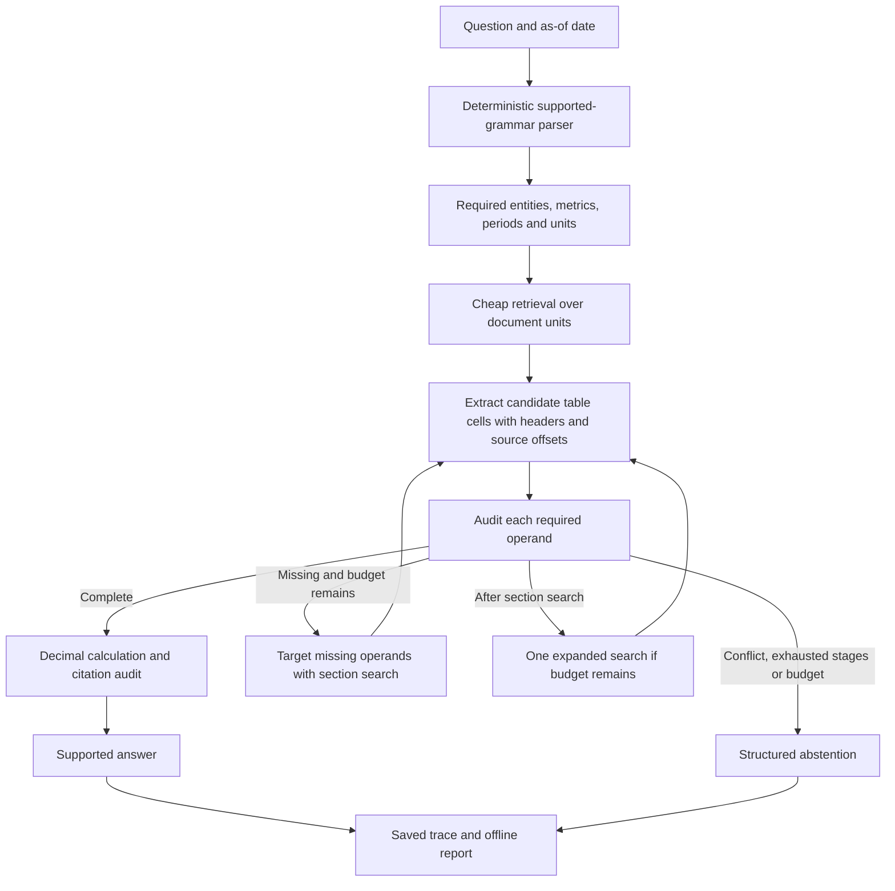

# Project 2: Evidence-Aware Budgeted Retrieval

Date: October 18, 2026, America/New_York. Status: proposed design; no v2 implementation or experimental results yet.

## Intent

Build Project 2 only, as an independent v2 extension of **Beyond Vector Search**. The user selected **applied AI / ML engineer** as the target role and wants credible evidence of capabilities that can support interviews and job offers. This project cannot guarantee either outcome; its deliverable is engineering that a hiring team can inspect, run and question.

The central question is: **Can checking which numerical evidence is missing guide additional retrieval more usefully than relevance or question complexity, within a measured budget?** Improvements remain hypotheses. A strong baseline winning is a valid finding.

The project should demonstrate retrieval, data engineering, numerical reasoning, evaluation, resource accounting, and engineering judgment. Model training is conditional on a demonstrated need. Neither a new name nor a polished chatbot is a milestone.

## Inputs and precedence

- User request: plan Project 2, with Superpowers, for applied AI/ML hiring evidence.
- Original specification: [folder 2 handoff](../handoffs/original-project-2.md).
- Shared constraints: [AI implementation handoff](../handoffs/original-ai-implementation-handoff.md).
- This design and its [execution plan](../plans/2026-10-18-evidence-aware-retrieval.md) resolve implementation choices without replacing the original scientific safeguards.
- Planning files live in folder `2`, following the workspace's existing convention. Copy these documents into the isolated product checkout at implementation time. No project code belongs in folder `1` or in the memory project.

## Observed starting point

Read-only inspection on October 18 found:

| Item | Observation | Consequence |
|---|---|---|
| Source checkout | the original local v1 checkout | Reuse its committed source through a separate clone |
| Revision | `675733109b30e80ce40c0a796bc0dd89e616c4ef`, branch `main` | Pin initial v2 baseline to this revision |
| Working changes | Modified `results/cost_report.json`; untracked legacy result directories and `scripts/build_evidence_complete_corpus.py` | Preserve; do not copy them into v2 implicitly |
| Published v1 | 150 filings, 30 companies, 43 questions, 172 records, 23 tests described by README | Historical exploratory results, not v2 evidence |
| Query file | v1 queries include `gold_answer` and gold evidence document IDs | Build a clean question-only export; never send the original records into inference |
| Corpus | Compressed normalized text plus metadata; 150 local HTML files, none tracked | HTML/source lineage must be copied explicitly and hashed; a fresh Git clone alone is insufficient for table extraction |
| Hardware | Apple M4 Pro, 24 GiB memory | CPU-first fixtures; measure resource fit before local model work |
| Python | Default is 3.14.7; existing uv-managed Python 3.12.9 is available | Create a separate 3.12 environment; do not mutate another project's environment |

The v1 result metric is a model-judge score, not exact numerical accuracy. Do not put its score beside v2 supported-correctness as if they were the same metric.

Recorded preservation inventory: `data/release/v1` has 8 files, aggregate SHA-256 `e08248e94c6ff2eaf39e46854f393641ce3a39b5d6d3048ca6692dcd32c31b1d`; `results/release_v1` has 18 files, aggregate SHA-256 `780f297bc7cae40750b77812df1b88f080877a7680a96c1ade71e5c999f469ef`. Aggregates hash compact, key-sorted JSON of path/SHA-256 records sorted by path. Save individual entries again at execution time.

## What we will build

Support a declared subset of SEC annual-filing questions: direct extraction, sums, year-over-year growth, and rankings across explicitly named entities and fiscal periods. Initially support consolidated reported revenue in USD and exact scale conversions. Broader metrics require versioned aliases and reviewed accounting definitions. Unsupported definitions, unresolved restatements, missing evidence and unsupported wording produce explicit abstentions.

The code records explicit stage history so this diagram's loops terminate: cheap search once, section search at most once, expanded search at most once. Empty retrieval advances history. There is at most one final answer-generation call. The offline executor uses no generation call.

Worked example: rank Alpha and Beta by FY2024 revenue growth over FY2023. Alpha has 100 and 120; Beta 200 and 220 USD million. Four operands are required. Alpha's table plus a Beta company mention provides only 2/4. Retrieve Beta's missing table, then calculate 20.00% and 10.00%. If Beta's filing was disclosed after the cutoff, the complete ranking must abstain.

## Technical boundaries and decisions

**Repository:** implementation default this checkout, branch `feat/evidence-aware-v2`, cloned from committed local history with `--no-hardlinks`, then set its origin to the existing public URL. Stop or reuse deliberately if that target already exists. No push or external publication in this planning task.

**Core:** Python >=3.11, implementation environment 3.12.9, frozen dataclasses, strict JSON, Decimal, pytest. Minimal offline dependencies only; no vector database service, cloud infrastructure, new orchestration framework or mandatory model download. Keep core imports free of provider SDK initialization and tokenizer downloads. Keep v1 interfaces and release files unchanged.

**Existing integration:** `BasePipeline` uses `load_corpus(str)` and `query(str) -> PipelineResult`. Its module loads dotenv and imports tiktoken; keep v2 core independent and import the compatibility adapter explicitly. Vector and section constructors initialize providers, so do not instantiate them for offline retrieval. Reimplement the small section-unit adapter with tests rather than importing a private method. `evaluation/__init__.py` eagerly imports the old evaluator: make its exports lazy, preserving import compatibility, so v2 offline evaluation does not require old provider dependencies.

**Units before evidence:** index `RetrievalUnit(id, doc_id, start, end, text, section_id, header_context)` from documents, not answer-key spans. `retrieve_units` ranks these units; the extractor turns selected units into candidate `EvidenceSpan` objects. The original `RetrievalBackend.retrieve(...) -> list[EvidenceSpan]` remains a facade over these two steps. Gold spans are available only to the evaluator. Handwritten spans are permissible in labeled unit fixtures, never as the live retrieval source.

**Table extraction:** parse local raw HTML with a pinned parser. Keep raw-byte hash, normalized-text hash, HTML table/row/cell locator, and raw-to-normalized segment mapping. A numeric cell must link to entity metadata, metric row, unit header and actual period column. For unsupported merged headers, ambiguous column mapping, broken lineage or absent raw HTML, abstain and report extraction failures. Do not reconstruct missing headers from references. Add merged-header support only with a failing real example and a scoped test.

**Query contract:** parse question plus `as_of` against public entity/metric aliases and a versioned public fiscal-calendar registry. `build_fiscal_calendar(documents, as_of)` reads only source fiscal-calendar metadata/XBRL contexts from filings disclosed by the cutoff; entries map `(entity_id, fiscal_year)` to exact start/end and source accession/hash. It contains no metric values or gold evidence IDs. The parser receives that registry explicitly; missing or conflicting dates produce `unknown_fiscal_calendar` abstention. Synthetic fixtures supply this metadata in their source documents. Calendar entries and their provenance are versioned as part of the inference corpus. Inference never loads `requirements` from human reference annotations. Structured `QuerySpec` inputs exist for explicitly labeled diagnostic tests; raw-question end-to-end scores and structured-spec diagnostic scores stay separate. The runtime parser returns an abstention for unsupported grammar rather than borrowing reference requirements.

**Evidence acceptance:** check entity, metric, accounting basis, full period, fiscal year, explicit convertible units, header/value association, disclosure cutoff, source hash and quote slice. Same-valued duplicate evidence is not a conflict; incompatible eligible values are. Conservative MVP policy: conflicting reported/restated candidates abstain until an explicit version policy is added. A date-only `as_of` means end of that UTC date; disclose this granularity and reject claims about intraday availability.

**Math:** Decimal only; extraction, sum, growth `(new-old)/old*100` and ranking. Reject mixed currencies, missing inputs, zero/negative growth bases, unsupported units and conflicts. Rank unrounded values; preserve ties; display percentages using ROUND_HALF_EVEN to two decimal places. No generated code execution. Every numerical claim cites its exact operand spans.

**Retrieval:** start with local BM25 over fixed table-aware units, `k1=1.2`, `b=0.75`, lowercase word tokenization, positive Robertson IDF variant, stable unit-ID tie breaks. Section search filters by missing entities/metrics and searches corresponding sections without gold document IDs; expanded search removes section restrictions within the allowed corpus. Before effectiveness claims, add dense, RRF hybrid (`sum(1/(60+rank))`, ranks start at 1), and a pinned reranker if resource fit permits. Same candidate units and final packing policy across matched comparisons. Mark an unavailable arm unavailable.

**Budgets:** default `provider_enabled=false`, `max_usd=0`. Pilot defaults are final context 8,192 tokens, final output 512 tokens, cheap pool 20, hybrid pool 60, at most 12 packed sections, three retrieval stages. Separate cumulative per-stage selector/verification tokens from final context. The executor checks coverage again after packing so dropping a needed cell cannot yield an answer. Use a pinned local tokenizer for model experiments; fixture estimates are labeled estimates. Stages also obey a monotonic deadline and explicit action history. A zero provider budget forbids all provider calls, including retries and judging.

**Cumulative limits:** author defaults are 8,192 inspected source tokens per retrieval stage, 24,576 inspected retrieval tokens total, 24,576 verification-input tokens total, and a 30,000 ms monotonic request deadline. These are separate from the 8,192-token final context and are matched across arms. `token_limit` bounds the returned source-unit text including headers before extraction, not the full offline index scored by BM25. Count repeated inspected text again on each stage; verify only within reserved input allowance; count indexing work separately. Use an explicit whitespace-token estimate for fixtures and a pinned model tokenizer for measured model comparisons. Record both units and tokenizer identity; local text-token counts are not billed API tokens. `BudgetState` gains retrieval/verification remaining counters. Exhausting either allowance prevents escalation; an expired deadline yields an abstention/timeout trace. Hard provider cancellation cannot be guaranteed after submission.

**Answer modes and fairness:** executor-only is the offline control. In the separate `model_qa` mode, `Answerer.answer(spec, spans)` receives only the raw question, cutoff and selected source evidence with IDs; the prompt excludes reference values and the computed executor result. Compute the deterministic result privately for final numerical/citation auditing. Every matched scheduling/strategy arm uses the same post-packing coverage, executor and citation checks; failure causes the same structured abstention. This measures retrieval plus the shared supported-answer system, not unrestricted model reasoning. Optional narration supplied with a computed answer is labeled narration and excluded from model-QA comparisons.

**Resource ledger:** log retrieval/router/verification/generation/indexing/judging separately. Record local wall time and peak memory; API cost zero means no API billing, not free compute. Unknown price/usage is null, and blocks a complete savings claim. Reserve conservative maximum usage before calls, charge all attempts, reconcile returned usage. Replay is replay: never present replay elapsed time as provider latency or imputed tokens as measured usage.

## Milestones and stop conditions

| Release | Concrete artifact | Exit condition | Planning estimate |
|---|---|---|---|
| A: offline engineering slice | Eight synthetic cases, CLI, JSONL traces and offline report | Contracts, source audit, bounded routing, arithmetic, budget failure paths and v1 preservation verified | 12–20 person-hours |
| B: real-filings engineering pilot | 12–20 development questions from at least four company groups, raw-table lineage, honest baseline report | End-to-end raw-question path measured; actual parser/extractor failures retained; no gold routing | Additional 12–20 person-hours |
| C: portfolio experiment | Strong retrieval controls, fixed answerer, pilot dataset, paired resource/quality analysis, demo and case study | All available arms disclosed, evidence-linked claims, reproducible artifacts and limitations | Additional 16–28 person-hours, plus annotation/provider time |
| D: conditional research | Locked held-out companies, temporal/external test and preregistered analysis | Independent labels and sufficient independent groups; fresh authorized runs | Re-estimate after C |

These are author estimates, not deadlines or measured productivity. The first session is a 90–120 minute checkpoint on Task 1, not a promise to finish Release A. A–C total 40–68 person-hours; at 8–10 hours/week dedicated here that is roughly 4–9 weeks. The source budget is shared across projects, so elapsed time is longer if attention remains split. Re-estimate after A.

No UI polish or learned router until the real-data failure analysis exists. If raw HTML extraction is unreliable, narrow supported layouts and quantify abstentions. If hybrid retrieval already resolves the failures, publish that result. Do not add a training phase to manufacture a favorable story.

## Evaluation that supports trust

Two separate tracks:

1. **Strategy:** BM25, dense, hybrid, hybrid+rerank and section selection; same units, final answerer/version/prompt/decoding, context and output caps. Include relevance-only packing at the same budget.
2. **Scheduling:** always-cheap, always-maximum-bounded, evidence rule and query-complexity control, with the same backend family and final answerer. Always-maximum runs all three stages regardless of early completeness. Optional learned routing follows a separate gate. A deterministic executor-only comparison is reported separately.

V1's 43 questions and all descendants remain development-only. The 12–20 real-source pilot is also development, not an untouched test. Its reference-assisted analysis may diagnose failures but never feed inference. For a later 100–200-item pilot, construct company/question connected components and group shared sources and derived templates before partitioning. Aim for at least 12 independent groups if feasible. A locked temporal experiment also separates source ancestry. Template edges mean shared derivation ancestry (the same base case, paraphrase family or generated source/value recipe), not merely use of a common public grammar such as “What was [company] FY[year] revenue?”. Track both separately; grammar overlap is disclosed as a limitation of company-holdout evaluation, not mislabeled unseen-language generalization. Never use a test question derived from a development base case. Redesign collection if one giant component prevents honest splits.

The primary quality measure is supported numerical correctness: correct value, all requested entities/periods, and entailed citations. Report answerable supported-success separately from correct abstention on unanswerable questions; include overall decision correctness with explicit denominators. Also show parser success, evidence recall, false completeness, citation precision, selective accuracy/answer rate, unsupported answers, failures, p50/p95 latency, peak memory, and resource totals. Keep timeouts/errors in denominators. Zero correct answers makes cost-per-correct null.

Independent humans must review confirmatory answers, evidence and arithmetic. A second reviewer covers at least 25%, including every unanswerable/conflict case. Agent or model review is explicitly labeled and can support an engineering release; it cannot satisfy the independent human gate. The user is not required to finish a large annotation exercise before any engineering demo can ship.

After development, preregister comparator, budget, power assumptions, primary endpoint, noninferiority margin and multiplicity before test outcomes. The handoff's 2 percentage-point margin and 15% cost reduction are candidates, not acceptance promises. Use paired 95% component-cluster bootstrap intervals, keeping repeated questions together. Fewer than 12 effective groups makes intervals descriptive and blocks a strong confirmatory conclusion. At least three fresh paired repetitions require a separately approved run budget. Nonsignificance does not establish noninferiority.

## What a hiring team can inspect

| Capability | Evidence artifact | Interview defense |
|---|---|---|
| Retrieval engineering | Matched BM25/dense/hybrid controls and per-question selected units | Explain which failure survives strong retrieval |
| Data engineering | Source lineage, table headers, hashes, leakage-safe manifests | Trace one result back to the exact source cell |
| Applied ML evaluation | Held-out groups, ablations, paired estimates, failures | Explain why a reported improvement is or is not supported |
| Reliable systems | Budget ledger, explicit stages, zero-budget tests, reproducible replay | Diagnose a timeout, missing price, or misleading cached result |
| Judgment and ownership | Decision log, real failure case study, limitations | Explain one rejected approach and a tradeoff without relying on generated prose |

Release C package: a README with a 60-second explanation; a runnable five-minute offline walkthrough; one missing-evidence recovery and one correct abstention; a fixed-config comparison table; quality/resource plot generated from saved artifacts; methods and limitations; source-level tests and a reproducibility manifest. A local trace viewer or static report suffices. Include an accurate statement of AI assistance and what the user personally inspected, changed and can explain. Resume bullets are written only from completed evidence, with run links and correct metric names. Publication and outreach are later explicit actions.

## Source checks and boundaries

Read methods/limitations from [When Learned Context Planning Fails to Beat Strong Retrieval](https://arxiv.org/html/2609.26976v1), checked October 18. Its bounded multiple-choice setting differs from this project; it motivates strong matched controls and leakage-safe routing, not a transferable performance claim. Publication/acceptance status is not asserted.

[LangChain's routing account](https://www.langchain.com/blog/how-to-build-a-model-router-in-the-harness), checked October 18, supports using traces and task outcomes to design routing. Its reported coding-agent gains are not this project's results.

[Elastic's RRF reference](https://www.elastic.co/docs/reference/elasticsearch/rest-apis/reciprocal-rank-fusion) defines rank fusion; use a local implementation, not an Elasticsearch deployment. [SEC's official access guidance](https://www.sec.gov/search-filings/edgar-search-assistance/accessing-edgar-data), checked October 18, specifies declared User-Agent and a current 10 request/second maximum. No collection is needed for A; later collection uses caching, backoff, declared real contact information and an aggregate limit below the rechecked ceiling.

## Assumptions left with the builder

Author defaults: separate checkout, Python 3.12, BM25 first, revenue-only initial real-data definition, conservative layout support, native sequential implementation, no spending, no model download for A. The builder may choose internal helper names and report layout while preserving public interfaces and checks. Model/provider selection is deferred until a resource probe and exact run estimate. Paid use, publication, confirmatory labels and novelty are not silently assumed.
